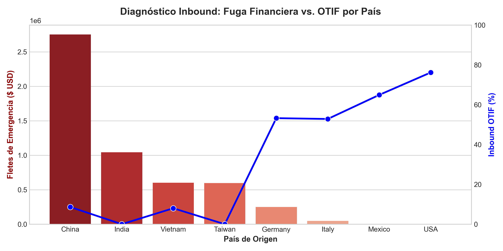
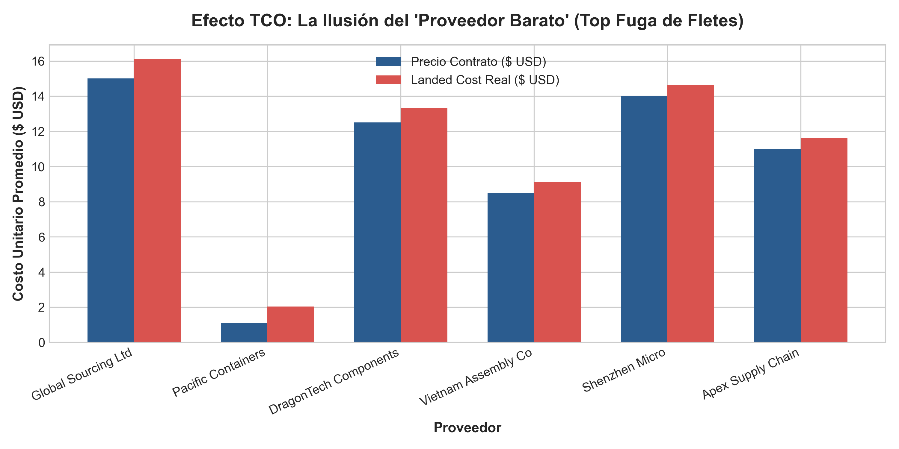

# 🚚 Inbound Supplier Performance & TCO Diagnostic
### Uncovering Hidden Financial Leakage in Offshore Sourcing Networks

---

## 📌 Executive Summary (BLUF)
An end-to-end diagnostic of **10,000 Purchase Orders (POs)** across **15 global suppliers** revealed a critical operational breakdown: an **Inbound OTIF (On-Time In-Full) of just 36.93%**, which triggered **$5.29M USD in emergency expedited freight costs**.

While Contract Purchase Prices ($PPV$) suggested that Asian sourcing was up to 40% cheaper than local alternatives, the severe lead time volatility ($\sigma = 18\text{ days}$) from offshore suppliers repeatedly forced the operation into air freight contingencies to prevent production stoppages.

A **Total Cost of Ownership (TCO)** evaluation demonstrated that **94.3% of the financial leakage originated in Asia**, eroding nominal contract savings. To resolve this, a two-phase strategic proposal was designed: a **60/40 Dual-Sourcing transition to Nearshoring (USA/Mexico)** to reclaim **$3.5M USD in annual freight waste**, followed by a Vendor Development Program to elevate Nearshoring OTIF from 76% to world-class benchmarks (>90%).

---

## 🏗️ Project Architecture & Workflow

- **data/**: `inbound_supplier_data.csv` (Synthetic dataset: 10,000 POs, 15 suppliers)
- **images/**: `01_country_otif_vs_freight.png` (Freight Leakage vs OTIF), `02_tco_contract_vs_landed.png` (Contract Price vs Landed Cost)
- **notebooks/**: `01_inbound_supplier_diagnostic.ipynb` (Complete EDA, KPI modeling, and visualizations)
- **README.md**: Executive case study

---

## 📊 Key Operational & Financial Findings

### 1. The Global Performance Breakdown
* **Inbound OTIF Global:** `36.93%` *(Benchmark: >90.00%)*
* **Total Expedited Freight Leakage:** `$5,294,702.70 USD`
* **Root Cause Mechanism:** Low average delay days but extremely high lead time standard deviation ($\sigma$). Extreme tail events (> 5 days delay) automatically trigger premium air freight.

### 2. Geographic Diagnostic: Offshoring vs. Nearshoring

| Origin Country | Total POs | Avg Lead Time Volatility ($\sigma$) | Inbound OTIF (%) | Expedited Freight Waste ($ USD) |
| :--- | :---: | :---: | :---: | :---: |
| **China** | 2,619 | 11.2 days | 8.63% | $2,750,911.41 |
| **India** | 725 | 18.0 days | 0.00% | $1,042,781.87 |
| **Vietnam** | 650 | 9.1 days | 8.00% | $601,530.15 |
| **Taiwan** | 607 | 11.0 days | 0.00% | $596,916.07 |
| **Germany** | 1,345 | 3.5 days | 53.23% | $250,404.78 |
| **Italy** | 672 | 3.0 days | 52.83% | $48,579.54 |
| **Mexico** | 2,064 | 1.8 days | 64.92% | $3,578.88 |
| **USA** | 1,318 | 1.2 days | 76.18% | $0.00 |

---

## 📈 Strategic Visualizations

### Regional Breakdown: OTIF vs. Freight Leakage

### The "Cheap Supplier" Illusion: TCO Analysis

---

## 💡 Financial Analysis: The "Cheap Supplier" Illusion

Traditional procurement metrics ($PPV$) reward buyers for securing lower contract prices. However, when evaluating the **Actual Landed Unit Cost**:

$$\text{TCO} = \text{Contract Price} + \left( \frac{\text{Expedited Freight}}{\text{PO Quantity}} \right)$$

Offshore suppliers consistently exceed budgeted costs.

* **P&L vs. Operational Impact:** Offshore suppliers destroy direct profitability (P&L) through emergency freight charges. Nearshoring suppliers protect P&L ($0.00 freight waste in USA), but cause minor operational friction due to mid-tier OTIF (76%).
* **Working Capital Drag:** Managing 45-day lead times with $\sigma = 18\text{ days}$ forces the company to maintain bloated safety stocks, tying up cash flow in warehousing space.

---

## 🎯 Executive Action Plan

### Phase 1: Immediate Financial Containment (0–3 Months)
* **Dual-Sourcing Framework (60/40):** Retain 60% baseline volume in Asia for low-variability components to preserve scale pricing. Shift 40% of volatile/high-velocity SKUs to Nearshoring networks (Mexico/USA).
* **Estimated Impact:** Immediate 70% reduction in air freight costs, recapturing **~$3.5M USD annually**.
* **Vendor SLAs:** Re-negotiate SLAs to include dynamic chargeback clauses where suppliers absorb expedited shipping costs caused by unannounced dispatch delays.

### Phase 2: Nearshoring Network Excellence (3–6 Months)
* **Vendor Development Program (VMI/EDI):** Establish Vendor-Managed Inventory hubs within 30 minutes of assembly plants and integrate real-time EDI/API tracking for local suppliers.
* **Benchmark Target:** Drive Mexico and USA Inbound OTIF from ~70% to **>90%**, eliminating micro-stoppages on assembly lines.

---

## 🛠️ How to Reproduce

1. **Clone the repository:**
   `git clone https://github.com/Joel43NT/inbound-supplier-performance-diagnostic.git`
2. **Install required packages:**
   `pip install pandas numpy matplotlib seaborn`
3. **Execute Analysis:**
   Open and run all cells in `notebooks/01_inbound_supplier_diagnostic.ipynb`.
